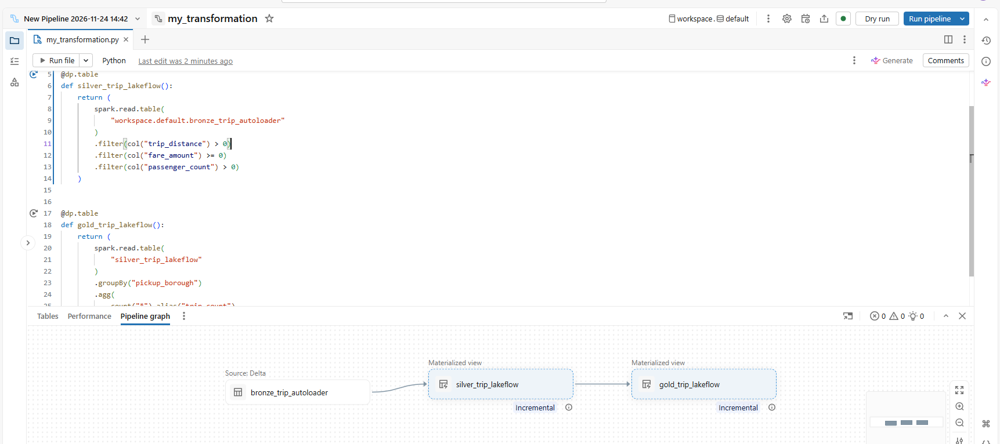
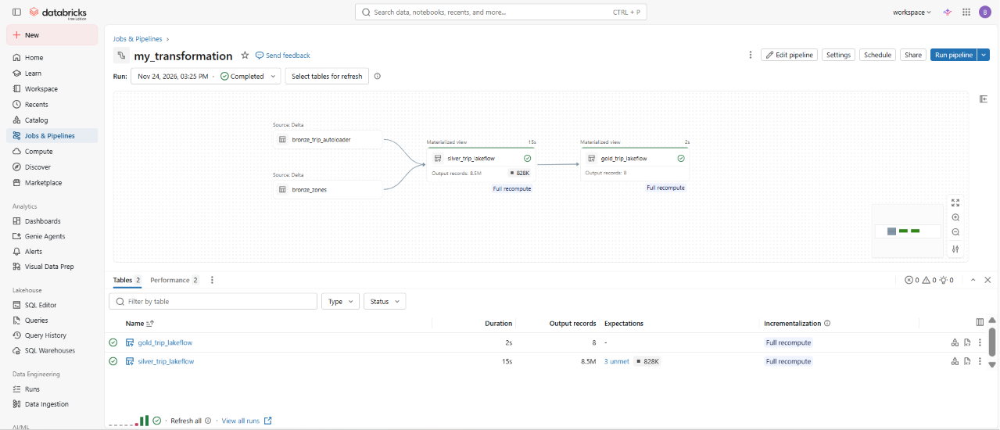
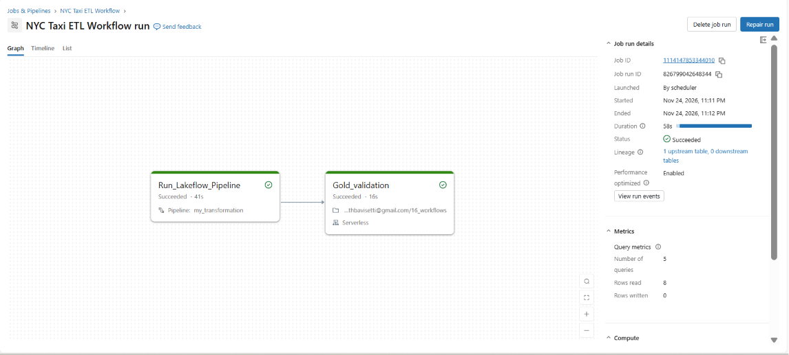
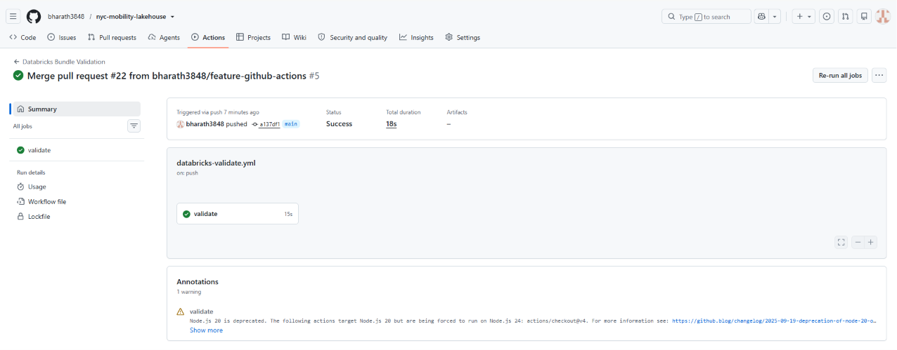

# NYC Mobility Lakehouse

## Project Overview

This project implements an end-to-end Databricks Lakehouse solution using the Medallion Architecture (Bronze, Silver, Gold) to process NYC mobility data from multiple sources including files, APIs, databases, and streaming events.

The solution demonstrates modern Databricks platform capabilities such as:

- Auto Loader
- Lakeflow Declarative Pipelines
- Unity Catalog
- Workflows
- Data Quality Testing
- Delta Lake Optimization
- Databricks Asset Bundles (DABs)
- GitHub Actions CI/CD

---

# Architecture

```text
                 ┌─────────────┐
                 │ Trip Files  │
                 └──────┬──────┘
                        │

                 ┌─────────────┐
                 │ Weather API │
                 └──────┬──────┘
                        │

                 ┌─────────────┐
                 │ PostgreSQL  │
                 └──────┬──────┘
                        │

                 ┌─────────────┐
                 │ Ride Events │
                 └──────┬──────┘
                        │

                    BRONZE
                        │
                        ▼

                    SILVER
                        │
                        ▼

                     GOLD
                        │
                        ▼

           Auto Loader + Lakeflow
                        │
                        ▼

             Databricks Workflows
                        │
                        ▼

             Data Quality Testing
                        │
                        ▼

                 DAB Deployment
                        │
                        ▼

              GitHub Actions CI/CD
```

---

# Technology Stack

## Platform

- Databricks Free Edition
- Delta Lake
- Unity Catalog
- Lakeflow Declarative Pipelines
- Databricks Workflows

## Languages

- Python
- PySpark
- SQL

## Data Sources

- Parquet Files
- CSV Files
- REST APIs
- PostgreSQL
- Structured Streaming Sources

## DevOps

- GitHub
- GitHub Actions
- Databricks Asset Bundles (DABs)

---

# Project Structure

```text
01_data_exploration

02_bronze_ingestion

03_bronze_zones

04_silver_trips

05_weather_api

06_silver_weather

07_customer_jdbc_ingestion

08_incremental_loading_cdc

09_scd_type1_type2

10_streaming_events

11_silver_ride_events

12_gold_kpis

13_autoloader

14_lakeflow_documentation

15_unity_catalog_documentation

16_workflows_documentation

17_testing

18_performance_optimization

19_databricks_asset_bundles

20_github_actions_documentation
```

---

# Key Features

## Medallion Architecture

Implemented Bronze, Silver, and Gold data layers for progressive refinement of raw data.

### Bronze

- Raw ingestion
- Schema preservation
- Incremental loads

### Silver

- Data cleansing
- Standardization
- Enrichment
- CDC processing

### Gold

- KPI generation
- Business reporting
- Analytics-ready datasets

---

# Data Engineering Concepts Implemented

## Incremental Processing

- CDC
- Delta MERGE
- Incremental Loads
- Auto Loader

## Dimensional Modeling

- SCD Type 1
- SCD Type 2

## Streaming

- Structured Streaming
- Watermarks
- Checkpointing

## Schema Management

- Schema Evolution
- Late Arriving Files

---

# SQL & Spark Features

## Transformations

- Joins
- Filters
- Aggregations
- Pivot

## Window Functions

- ROW_NUMBER()
- RANK()
- DENSE_RANK()
- LEAD()
- LAG()

## Spark Optimization

- cache()
- persist()
- broadcast()
- explain()

---

# Delta Lake Features

- MERGE
- Time Travel
- Change Data Feed (CDF)
- OPTIMIZE
- VACUUM
- Delta History

---

# Auto Loader

Implemented incremental file ingestion using:

```python
cloudFiles
```

Features:

- Incremental File Discovery
- Schema Evolution
- Checkpointing
- Late Arriving File Handling

---

# Lakeflow

Implemented managed ETL pipelines using:

```python
from pyspark import pipelines as dp
```

Pipeline Architecture:

```text
bronze_trip_autoloader
          +
      bronze_zones
          ↓
silver_trip_lakeflow
          ↓
gold_trip_lakeflow
```

Features:

- Declarative Pipelines
- Data Quality Expectations
- Pipeline Monitoring
- Managed Tables

---

# Unity Catalog

Implemented and explored:

- Catalogs
- Schemas
- Volumes
- Permissions
- Lineage
- Governance
- Information Schema

---

# Databricks Workflows

Implemented workflow orchestration using:

```text
Scheduled Trigger
         ↓
Run Lakeflow Pipeline
         ↓
Data Validation
         ↓
Email Notification
```

Features:

- Scheduling
- Task Dependencies
- Monitoring
- Notifications
- Run History

---

# Data Quality Framework

Implemented automated validation checks:

- Row Count Validation
- Null Checks
- Duplicate Checks
- Business Rule Validation
- Reconciliation Checks

Output:

```text
workspace.default.data_quality_report
```

---

# Performance Optimization

Implemented:

- Cache
- Persist
- Broadcast Joins
- Explain Plans
- Delta Time Travel
- Change Data Feed (CDF)
- OPTIMIZE
- VACUUM

---

# Databricks Asset Bundles (DABs)

Implemented Infrastructure as Code using:

```text
databricks.yml
resources/workflow.yml
```

Features:

- Workflow as Code
- Environment Configuration
- Automated Deployment Configuration
- Version Controlled Assets

---

# CI/CD

Implemented end-to-end deployment using:

```text
GitHub
      ↓
GitHub Actions
      ↓
Bundle Validation
      ↓
Bundle Deployment
      ↓
Databricks Workspace
```

Tools Used:

- GitHub Actions
- Databricks CLI
- Databricks Asset Bundles

---

# Key Outcomes

✅ End-to-End Lakehouse Implementation

✅ Medallion Architecture

✅ CDC & SCD Processing

✅ Streaming & Auto Loader

✅ Lakeflow Declarative Pipelines

✅ Unity Catalog Governance

✅ Workflow Automation

✅ Automated Data Testing

✅ Delta Lake Optimization

✅ Infrastructure as Code

✅ CI/CD Deployment

---

# Future Enhancements

- Kafka Integration
- Multi-Environment Deployments
- Service Principals
- Terraform Integration
- Monitoring Dashboards
- Great Expectations Framework

---

# Screenshots
## Auto Loader



## Lakeflow Pipeline



## Unity Catalog Lineage



## Workflow DAG


## Data Quality Report


## GitHub Actions Deployment


---

# Author

**Bharath Venkat Kalyan Bavisetti**

Databricks | PySpark | Delta Lake | Data Engineering | CI/CD

---

## Project Status

✅ Completed

This project demonstrates an end-to-end implementation of a modern Databricks Lakehouse platform covering Data Engineering, Platform Engineering, Governance, Testing, Optimization, DevOps, and CI/CD practices.